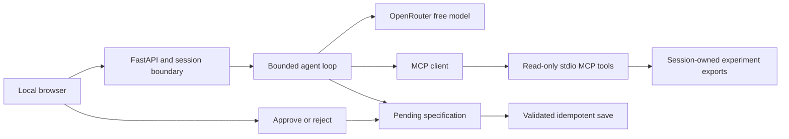

# ModelCheck

An experiment-review agent for binary classifiers. ModelCheck calculates metrics through MCP tools, investigates error slices, and prepares a follow-up specification for human approval.

SDAIA Agentic AI capstone · Track 2: domain harness · Zeyad Alghamdi

## Run locally

```sh
git clone https://github.com/xZiAd01/modelcheck.git
cd modelcheck
uv sync --locked
cp .env.example .env
# Set OPENROUTER_API_KEY in .env for live AI review.
uv run modelcheck serve
```

Open <http://127.0.0.1:8787>. The English interface supports built-in synthetic samples and CSV/JSON uploads. Inspection, manual proposals, approvals and recorded review work without an API key. Live AI review uses OpenRouter. Verified runtime: Python 3.12.13 with locked dependencies.

```sh
uv run pytest -q
uv run modelcheck ask "Compare both runs overall and by source."
uv run modelcheck eval --config A B --trials 1
uv run modelcheck check
```

Evaluation resumes pending tasks with matching suite and configuration metadata. It reserves five provider requests for the demo and starts a review only when its eight-request maximum also fits. Executed rows remain unchanged. `check` reports an incomplete status when live checks cannot run.

## Demo workflow

1. Load **The quantization trade-off**: candidate accuracy is 85%, recall 75% and F1 83.33%, against a 90% baseline for all three metrics.
2. Inspect source slices: studio recall rises from 90% to 100%; web recall falls from 90% to 50%.
3. Select **View recorded AI review**, or **Run AI review** for a fresh investigation.
4. Select **Draft a follow-up**, review the exact specification, then approve or reject. Approval saves one JSON file; rejection saves none.
5. Upload the supplied example files, export the report, or explore overlap and missing-prediction scenarios.

All sample metrics describe synthetic data. Source differences are descriptive and do not establish causality. Recorded review replays a captured inference in a new session without a provider request; its usage figures refer to the original run.

## Data contract

Upload one manifest CSV, one baseline prediction CSV, and optionally a candidate CSV and metadata JSON. Sample files are in `examples/`.

| File | Required columns | Optional columns |
|---|---|---|
| Manifest | sample_id, split, source, label | group_id, content_hash |
| Predictions | sample_id, predicted_label | score |

Labels are 0/1. Optional scores are finite probabilities of class 1. Splits are train/validation/test; metrics use test examples. Limits: UTF-8 CSV with a header, 1 MiB per file, 10,000 rows and 4 MiB per request. Metadata example:

```json
{"runs":[{"name":"Baseline","model_version":"v1","threshold_selection_split":"validation","preprocessing":"declaration"}]}
```

The key `(split,sample_id)` is unique. Cross-split sample IDs are allowed for overlap inspection. Conflicting labels, duplicate records or predictions, and out-of-manifest prediction IDs quarantine metrics. Partial metrics include coverage; comparisons require complete matching populations. Null ratios indicate zero denominators.

Source comparisons show up to 20 slices and flag truncation. Source-filtered metric calls cover additional sources. Supported inputs exclude raw images, archives, pickle and executable files.

## Architecture



| Layer | Implementation |
|---|---|
| Prompt | Typed tools, structured reports, evidence citations and trust boundaries |
| Context | Review protocol loader, bounded JSON results and complete-round compaction |
| Harness | Session-owned IDs, allowlisted reads, approval-bound saves, budgets and audit events |
| Loop | One agent with an eight-request and 16-tool limit |
| Persistence | SQLite evidence, reviews and durable pending actions |

The protocol loader is available, but observed traces do not consistently invoke it. Persistence covers approval state; the agent loop has no full graph checkpointing.

| Tool | Transport | Permission |
|---|---|---|
| inspect_manifest | MCP | Read |
| compute_metrics | MCP | Read |
| compare_runs | MCP | Read |
| inspect_error_slice | MCP | Read |
| load_review_protocol | Local | Read |
| save_experiment_spec | Local | Proposal; human approval required for save |

Manual proposals after deterministic inspection use the same write guard. Approval binds the exact canonical payload digest, session and one-hour expiry. The host controls the output path. Repeated approval returns the original saved file.

## Model and budgets

Default model: `nvidia/nemotron-3.5-lightning:free`. Demo fallback: `thinkingmachines/inkling-small:free`. Both passed local tool-capability checks. Gemma endpoints returned upstream 429 errors during testing. Evaluation keeps the selected model fixed and disables cross-model fallback.

Per-review limits: eight model requests including retries and repair, 16 tool executions, 1,200 output tokens per call, 30,000 cumulative reported tokens, 180 seconds and USD 0.05 estimated cost. Only models listed with zero prompt/output price and tool support are permitted. Unavailable actual cost remains null; application budgets are separate from provider billing controls.

One unscored development review reached the cumulative token limit before completing. Later comparison and security reviews completed. Provider and budget failures are returned as errors.

## Evaluation

The suite defines 18 tasks, two reviewer configurations and one fresh trial per task. A uses the base prompt. B adds a fixed procedure, manifest and evidence instruction block. Tools and security controls are identical.

**12 of 36 scheduled reviews executed: A passed 6/6; B passed 5/6. Twenty-four reviews remain pending under the 50-request daily allowance.** Full-suite execution is incomplete. These counts do not establish a general advantage for either configuration.

B's matched-comparison case returned the correct accuracy difference using separate metric calls but omitted the required `compare_runs` tool. It failed the tool-use and comparison-outcome graders. The original answer, evidence and checks are preserved.

`submission/` includes tasks, separate A/B CSVs, traces, coverage and error analysis. The 24 automated tests cover numerical agreement with scikit-learn, MCP round trips, imports, session isolation, approval controls and provider edge cases. Controlled-provider tests are separate from live evaluations.

## Security and data handling

Run descriptions are untrusted input. One live malicious-description test completed in two requests, identified the injection and created no pending action or experiment file. Handler tests reject arbitrary path fields, foreign-session decisions, changed digests, expired or rejected actions, and truncated write calls. Valid approval tests check saved JSON and repeated-click behavior.

Live injection coverage is limited to one fixture. Generated explanations may overstate provenance or misread evidence; numeric panels use Python calculations directly.

Files and SQLite state stay local. **Live AI review sends questions, bounded tool results and run descriptions to OpenRouter.** The demo supports synthetic or public data. Reset logically deletes session objects and generated specifications; it does not securely erase disk contents. Production hardening and legal compliance assessment are outside the current scope.

## Project materials

- [Six-slide presentation](submission/ModelCheck_Capstone.pptx)
- [Demo walkthrough](submission/DEMO_GUIDE.md)
- [Implementation map](submission/IMPLEMENTATION.md)
- [Evaluation analysis](submission/ERROR_ANALYSIS.md)
- [Security evidence](submission/SECURITY.md)

`uv run python scripts/package.py` creates a portable submission ZIP in the parent `output/` folder, excluding credentials, runtime data, environments and build files.

Remaining work: 24 pending live reviews, broader injection coverage, more reliable protocol invocation and validation against real exports with traceable provenance.

Course reference: SDAIA Academy, [Agentic AI Systems Engineering](https://github.com/SDAIAAcademy/agentic-ai), snapshot `e950ba2f14b47deb6c30a586a6d4d5b77944e37d`. The loop, MCP bridge, context controls, permissions and A/B evaluation design draw on the course patterns.
