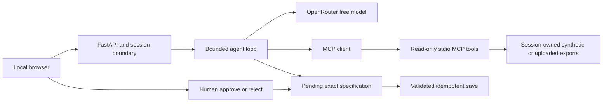

# ModelCheck

An experiment-review agent for developers working with binary classifiers. It calculates results through MCP tools, investigates errors, and prepares a follow-up specification for human approval.

**SDAIA capstone track:** 2, domain harness. **Presenter:** Zeyad Alghamdi. **Delivery:** local browser, English, built-in synthetic examples and CSV/JSON uploads.

## Run

```sh
cd modelcheck
uv sync --locked
cp .env.example .env
# Add OPENROUTER_API_KEY locally. Never commit or paste it in chat.
uv run modelcheck serve
```

Verified runtime: Python 3.12.13 with locked dependencies.

Open <http://127.0.0.1:8787>. Data inspection, upload, manual proposal/approval and recorded review work without an API key. Live AI review uses OpenRouter. If the port is already occupied by the existing ModelCheck process, use the running page rather than starting a second copy.

```sh
uv run pytest -q
uv run modelcheck ask "Compare both runs overall and by source."
uv run modelcheck eval --config A B --trials 1
uv run modelcheck check
```

Evaluation resumes previously pending tasks with the same suite/configuration metadata. It reserves at least five provider requests for the demo and refuses to start a review unless its eight-request maximum also fits. Existing executed rows stay unchanged. `check` reports incomplete if live checks cannot run. No command purchases credits or enables paid inference.

## Demonstration

1. Load **The quantization trade-off**. Inspect candidate accuracy 85%, recall 75% and F1 83.33% against the 90% baseline. These are synthetic examples.
2. The studio source's recall rises from 90% to 100%, while web recall falls from 90% to 50%. This describes the difference; it does not establish a causal reason.
3. Use **View recorded AI review** for a real captured model run, labeled as replay, or run a fresh AI review if quota permits.
4. Select **Draft a follow-up**, inspect the exact specification, then approve or reject. Approval saves exactly one JSON file; rejection saves none.
5. Use **Upload files** with the supplied examples, export the report, or inspect the overlap/missing-prediction scenarios.

Recorded review is a genuine synthetic-data inference, not a fabricated transcript. Replay creates a new session-scoped view without a model request. Its usage figures describe the original run.

## Data format

Upload one manifest CSV, one baseline prediction CSV and optionally a candidate CSV and metadata JSON. Example files live in `examples/`.

| File | Required columns | Optional columns |
|---|---|---|
| Manifest | sample_id, split, source, label | group_id, content_hash |
| Predictions | sample_id, predicted_label | score |

Labels are 0/1; scores, when present, are finite probabilities of class 1. Manifest splits are train/validation/test; metrics use test examples. UTF-8 CSV with a header, 1 MiB per file, at most 10,000 rows and 4 MiB per request. Metadata uses `{"runs":[{"name":"Baseline","model_version":"v1","threshold_selection_split":"validation","preprocessing":"declaration"}]}`.

The key `(split,sample_id)` is unique. Cross-split sample IDs are allowed so the inspector can identify overlap. Conflicting labels, duplicate records/predictions and out-of-manifest prediction IDs quarantine metrics. Missing predictions remain explicit, partial metrics show coverage, and comparisons require full matching populations. Null ratios have zero denominators and must not be read as zero.

Source comparisons show at most 20 slices, explicitly flagged when truncated. Use source-filtered metric calls for additional sources. No raw images, arbitrary files, archives, pickle or shell commands are supported.

## Design across the ladder

| Layer | Implementation | Reason |
|---|---|---|
| Prompt | Typed tools, constrained report, trust boundaries | Tie explanations to measured evidence |
| Context | Review protocol skill/loader, bounded valid JSON and complete-round compaction | Retrieve guidance without raw CSV context |
| Harness | Session-owned IDs, allowlisted reads, approval-bound save, budgets, audit | Keep model suggestions within application controls |
| Loop | One explicit tool loop, 8-request/16-tool maximum | Investigations need different tool sequences |
| Graph | Pending action state in SQLite | Approval can happen later without rerunning inference |

No LangGraph or additional agents. SQLite stores durable approval state; this does not imply a fully checkpointed agent graph. The runtime provides a protocol loader; observed model traces do not consistently invoke it, a documented context-following limitation.



## Tools and permissions

| Tool | Read/write | MCP | Approval |
|---|---|---|---|
| inspect_manifest | Read | Yes | No |
| compute_metrics | Read | Yes | No |
| compare_runs | Read | Yes | No |
| inspect_error_slice | Read | Yes | No |
| load_review_protocol | Read | Local | No |
| save_experiment_spec | Pending proposal then write | Local | Required for the file save |

The API can also create a human-authored proposal after deterministic inspection. UI, CLI and evaluations share the same calculations and write guard. The model cannot select the output path or alter ownership. Approval binds a canonical digest, session and one-hour expiry. Repeated approval returns the original saved file.

## Model, budgets and observed failures

Runtime model: `nvidia/nemotron-3.5-lightning:free`, with an optional verified free fallback `thinkingmachines/inkling-small:free` for the demo. The planned Gemma endpoints returned upstream 429 errors during development. A direct free NVIDIA call and MCP-backed investigations succeeded. The final runtime choice rests on this small local validation, not a claim of benchmark superiority.

Every review allows at most eight model requests (repair/retry included), 16 tool executions, 1,200 output tokens per call, 30,000 cumulative reported tokens, 180 seconds and USD 0.05 estimated cost. Models must be listed with zero prompt/output price and tool support. Actual cost may be unavailable and remains null; an app budget does not replace provider billing controls. Evaluation disables cross-model fallback.

One early development review hit its cumulative token limit while creating a proposal; it was not counted as a completed review. Later comparison and security reviews completed. Provider and budget failures remain visible in output rather than receiving fabricated explanations.

## Evaluation status

The suite defines 18 tasks, two reviewer configurations and one fresh trial per task. A is the base prompt. B adds one fixed procedure/manifest/evidence instruction block. Both have identical tools and security controls.

**Quota-constrained run: 12 of 36 scheduled reviews executed. A passed 6/6; B passed 5/6. Twenty-four reviews remain pending.** The user selected the existing 50-request daily allowance. This is partial coverage and does not meet the full-suite execution requirement yet. It does not establish that either configuration is generally better.

The B matched-comparison case calculated a correct numerical difference using separate metrics but omitted the required comparison tool. Its tool-compliance and comparison-outcome graders failed. The exact answer and checks are preserved. Review grader scope before drawing a broader quality conclusion; never rewrite recorded results to hide the failure.

`submission/` contains task definitions, separate A/B CSVs, full synthetic traces, coverage summary and error analysis. Model-free tests independently check numerical calculations against scikit-learn, real MCP, imports, ownership, approvals and provider edge cases. Controlled-provider tests are contract tests and never counted as live model evaluation.

## Security and data

Run descriptions are untrusted. The live malicious-description scenario completed in two requests, reported the injection and created no pending save or experiment file. Handler tests separately reject arbitrary path fields, foreign-session actions, changed digests, expired/rejected decisions and truncated tool calls. Benign approved-save tests verify actual JSON contents and repeated-click behavior.

This demonstrates these fixtures and code controls, not universal prompt-injection resistance. AI prose can still overstate provenance or misread evidence. Numeric panels come directly from Python; users must inspect explanatory claims.

Files and SQLite state stay local. **AI review sends questions, bounded tool results and run descriptions to OpenRouter. Local UI does not imply local inference.** Use synthetic/public data only; do not upload personal or confidential records. Reset removes session objects and generated specifications but is not secure disk erasure. No PDPL certification or production readiness is claimed.

## Submission and limitations

Use the standalone ZIP and slide deck in the parent output folder. Keep the original course repository separate. The remaining work is the 24 pending fresh reviews once quota allows, broader red-team coverage, stronger procedure invocation, real export provenance, and user rehearsal/ownership confirmation.

Course reference: SDAIA Academy, [Agentic AI Systems Engineering](https://github.com/SDAIAAcademy/agentic-ai), source snapshot `e950ba2f14b47deb6c30a586a6d4d5b77944e37d`. Adapted concepts include the loop, MCP bridge, context controls, permissions and A/B evaluations. The standalone domain tools, fixtures, local UI, approval executor and tests were developed here with Codex assistance. Zeyad should review and be able to explain these before claiming independent implementation ownership.
