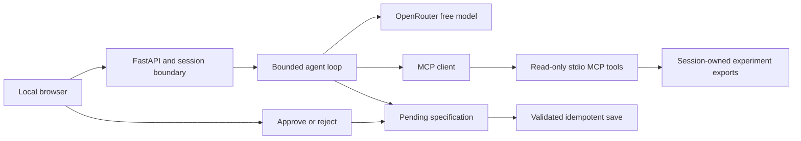

# ModelCheck

An experiment-review agent for binary classifiers. ModelCheck calculates metrics through MCP tools, investigates error slices, and prepares a follow-up specification for human approval.

SDAIA Agentic AI capstone · Track 2: domain harness · Zeyad Alghamdi

## Run locally

```sh
git clone https://github.com/xZiAd01/modelcheck.git
cd modelcheck
uv sync --locked
cp .env.example .env
# Set OPENROUTER_API_KEY in .env for live AI review.
uv run modelcheck serve
```

Open <http://127.0.0.1:8787>. The English interface supports built-in synthetic samples and CSV/JSON uploads. Inspection, manual proposals, approvals and recorded review work without an API key. Live AI review uses OpenRouter. Verified runtime: Python 3.12.13 on macOS with locked dependencies. Evaluation locking uses POSIX advisory locks.

Expand **How ModelCheck works** above the workspace for the workflow, review modes, metric definitions and data-handling explanation.

```sh
uv run pytest -q
uv run modelcheck ask "Compare both runs overall and by source."
uv run modelcheck eval --runtime-version v1 --config A B --trials 1
# After the v1 suite finishes:
uv run modelcheck eval --runtime-version v2 --config A B --trials 1
uv run modelcheck check
```

Evaluation resumes pending tasks only when runtime, task, prompt, schema, grader and dependency fingerprints match. It requires at least 13 remaining requests before a trial: eight maximum plus five reserved for the demo. V1 finishes before v2 can consume evaluation quota. `check` runs the automated tests and uses an isolated `runtime/smoke/` directory for live smoke checks; it returns an incomplete status while v1 is pending or live checks cannot run. Exit codes: 0 for completed passing runs, 1 for completed runs with failures, 2 for incomplete runs.

## Demo workflow

1. Load **The quantization trade-off**: candidate accuracy is 85%, recall 75% and F1 83.33%, against a 90% baseline for all three metrics.
2. Inspect source slices: studio recall rises from 90% to 100%; web recall falls from 90% to 50%.
3. Select **View recorded AI review** for the captured v1 run, or **Run AI review** for the current v2 agent.
4. Select **Draft a follow-up**, review the exact specification, then approve or reject. Approval saves one JSON file; rejection saves none.
5. Upload the supplied example files, export the report, or explore overlap and missing-prediction scenarios.

All sample metrics describe synthetic data. Source differences are descriptive and do not establish causality. Recorded review replays a captured inference in a new session without a provider request; its usage figures refer to the original run.

## Data contract

Upload one manifest CSV, one baseline prediction CSV, and optionally a candidate CSV and metadata JSON. Sample files are in `examples/`.

| File | Required columns | Optional columns |
|---|---|---|
| Manifest | sample_id, split, source, label | group_id, content_hash |
| Predictions | sample_id, predicted_label | score |

Labels are 0/1. Optional scores are finite probabilities of class 1. Splits are train/validation/test; metrics use test examples. Limits: UTF-8 CSV with a header, 1 MiB per file, 10,000 rows and 4 MiB per request. Metadata example:

```json
{"runs":[{"name":"Baseline","model_version":"v1","threshold_selection_split":"validation","preprocessing":"declaration"}]}
```

The key `(split,sample_id)` is unique. Cross-split sample IDs are allowed for overlap inspection. Conflicting labels, duplicate records or predictions, and out-of-manifest prediction IDs quarantine metrics. Partial metrics include coverage; comparisons require complete matching populations. Null ratios indicate zero denominators.

Source comparisons show up to 20 slices and flag truncation. Source-filtered metric calls cover additional sources. Supported inputs exclude raw images, archives, pickle and executable files.

## Architecture



| Layer | Implementation |
|---|---|
| Prompt | Typed tools, structured reports, evidence citations and trust boundaries |
| Context | Host-loaded v2 protocol with a version/hash, bounded JSON results and complete-round compaction |
| Harness | Session-owned IDs, allowlisted reads, approval-bound saves, budgets and audit events |
| Loop | One agent with an eight-request and 16-tool limit |
| Persistence | SQLite evidence, reviews and durable pending actions |

The current v2 host loads the packaged protocol before the first provider request, records a `protocol_loaded` event with its SHA-256 and retains the guidance during compaction. Missing, unreadable, blank, invalid UTF-8 or oversized protocols stop the review before inference. The limit is 4 KiB. The preload counts as one of 16 executions, leaving up to 15 model-selected calls. V1 retains its original on-demand loader and observed invocation limitation. Persistence covers approval state; the agent loop has no full graph checkpointing.

| Tool | Transport | Permission |
|---|---|---|
| inspect_manifest | MCP | Read |
| compute_metrics | MCP | Read |
| compare_runs | MCP | Read |
| inspect_error_slice | MCP | Read |
| load_review_protocol | Local | Read |
| save_experiment_spec | Local | Proposal; human approval required for save |

Manual proposals after deterministic inspection use the same write guard. Approval binds the exact canonical payload digest, session and one-hour expiry. The host controls the output path. Repeated approval returns the original saved file.

## Model and budgets

Default model: `nvidia/nemotron-3.5-lightning:free`. Demo fallback: `thinkingmachines/inkling-small:free`. Both passed local tool-capability checks. Gemma endpoints returned upstream 429 errors during testing. Evaluation keeps the selected model fixed and disables cross-model fallback.

Per-review limits: eight model requests including retries and repair, 16 tool executions, 1,200 output tokens per call, 30,000 cumulative reported tokens, 180 seconds and USD 0.05 estimated cost. Only models listed with zero prompt/output price and tool support are permitted. Unavailable actual cost remains null; application budgets are separate from provider billing controls.

One unscored development review reached the cumulative token limit before completing. Later comparison and security reviews completed. Provider and budget failures are returned as errors.

## Evaluation

Each runtime has 18 tasks, two reviewer configurations and one fresh trial per task. A uses the base prompt; B adds a fixed investigation-procedure instruction. Tools and security controls match within each runtime. V1 uses the frozen original reviewer. V2 adds host protocol loading to both configurations and clarifies comparison-tool use.

**V1: 12 of 36 scheduled reviews executed: A passed 6/6; B passed 5/6. Twenty-four reviews remain pending under the 50-request daily allowance.** Full-suite execution is incomplete. These counts do not establish a general advantage for either configuration.

V1 B's matched-comparison case returned the correct accuracy difference using separate metric calls but omitted the required `compare_runs` tool. It failed the tool-use and comparison-outcome graders. The original answer, evidence and checks are preserved.

**V2: 0 of 36 live reviews executed.** Its separate suite is pending until v1 completes. The application uses v2, while the recorded replay and existing live scores belong to v1. V2 has controlled-provider and browser integration coverage; live improvement is unmeasured.

`submission/` retains v1's current tasks, separate A/B CSVs and traces. `COVERAGE.md` is generated; `ERROR_ANALYSIS.md` remains a separate narrative. `evaluations/v1/initial/` preserves original source and evidence with checksums. Metadata for the original 12 executions was recovered from the published release, rather than recorded during those executions. New executions capture fingerprints and requested/served model IDs directly. Provider behavior may vary across quota windows.

V2 outputs use `submission/evaluations/v2/<fingerprint>/`. Progress writes use atomic replacement and checksummed traces; a trace committed before an interrupted progress write is recovered without repeating inference. Configuration mismatches and changed traces stop resumption. Failed attempts remain recorded.

The latest resumption found **zero provider requests remaining** and stopped before inference. The five-request reserve is an execution policy, not an available balance. See [timestamped quota status](submission/QUOTA_STATUS.json). The recorded walkthrough remains usable without inference quota.

A targeted rerun uses a separate result directory and does not replace full-suite scores:

```sh
uv run modelcheck eval --runtime-version v2 --config B --task matched-comparison
```

`--output PATH` selects a new directory explicitly. V2 cannot write to the v1 submission root, and the initial snapshot is protected from evaluation writes.

The 56 automated tests cover numerical agreement with scikit-learn, real MCP, imports, session isolation, approvals, protocol loading and compaction, checkpoint recovery, version selection and quota gates. Controlled-provider tests are separate from live evaluations.

## Security and data handling

Run descriptions are untrusted input. One v1 live malicious-description test completed in two requests, identified the injection and created no pending action or experiment file. Handler tests reject arbitrary path fields, foreign-session decisions, changed digests, expired or rejected actions, and truncated write calls. Valid approval tests check saved JSON and repeated-click behavior.

Live injection coverage is limited to one fixture. Generated explanations may overstate provenance or misread evidence; numeric panels use Python calculations directly.

Files and SQLite state stay local. **Live AI review sends questions, bounded tool results and run descriptions to OpenRouter.** The demo supports synthetic or public data. Reset logically deletes session objects and generated specifications; it does not securely erase disk contents. Production hardening and legal compliance assessment are outside the current scope.

## Project materials

- [Six-slide presentation](submission/ModelCheck_Capstone.pptx)
- [Demo walkthrough](submission/DEMO_GUIDE.md)
- [Demo video and captions](submission/demo/README.md)
- [Implementation map](submission/IMPLEMENTATION.md)
- [Evaluation analysis](submission/ERROR_ANALYSIS.md)
- [Security evidence](submission/SECURITY.md)
- [Evaluation layout and resumption](submission/evaluations/README.md)
- [Validation status](submission/VALIDATION.md)

`uv run python scripts/package.py` creates a portable submission ZIP in the parent `output/` folder, excluding credentials, runtime data, environments and build files.

Remaining work: 24 pending v1 reviews, 36 pending v2 reviews, repeated-trial reliability, broader live injection coverage and validation against real exports with traceable provenance. Screen-reader speech output remains unverified. Evaluation resumes in a later execution session when quota permits; no background schedule is configured.

Course reference: SDAIA Academy, [Agentic AI Systems Engineering](https://github.com/SDAIAAcademy/agentic-ai), snapshot `e950ba2f14b47deb6c30a586a6d4d5b77944e37d`. The loop, MCP bridge, context controls, permissions and A/B evaluation design draw on the course patterns.
